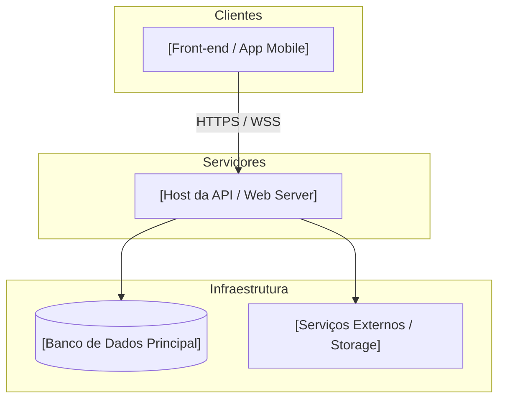

# Arquitetura do Sistema e Topologia

**Projeto:** [Nome do Projeto]
**Estilo Arquitetural Base:** [Ex: Clean Architecture Enxuta / Vertical Slice / MVC Clássico]

> **Trava de Inicialização (Fail-Fast):** Se houver marcações vazias com colchetes como `[Nome do Projeto]` ou `[Regra de Dependência]` neste arquivo, PARE e avise o usuário que a topologia da arquitetura precisa ser definida antes de alterar estruturalmente o projeto.

> **Regra Mestra para a IA:** Este documento define as fronteiras físicas e lógicas do software. É ESTRITAMENTE PROIBIDO adicionar novos projetos (`.csproj`, `.sln`, pacotes npm raiz), cruzar referências não autorizadas ou alterar a ordem do pipeline de middlewares sem consultar e respeitar as regras abaixo. **Sempre que um novo banco de dados, API externa ou projeto físico for adicionado ao sistema, VOCÊ DEVE atualizar os diagramas Mermaid abaixo.**

## 1. Estrutura de Pastas e Topologia de Nuvem (Fronteiras Físicas)
*Mapeamento exato de onde o código roda e com quem ele se comunica.*



- **`[NomeDoProjeto.Api]`**: Ponto de entrada (Web API, Controllers, Program.cs). Hospedado em `[Local de Deploy]`. Não possui regra de negócio estrita, apenas orquestração HTTP e DTOs.
- **`[NomeDoProjeto.Domain]`**: Coração do sistema. Contém entidades, interfaces, enums e serviços de domínio puro. NENHUMA dependência externa é permitida aqui.
- **`[NomeDoProjeto.Infrastructure]`**: Implementação técnica. Banco de dados (EF Core, Repositórios reais), chamadas HTTP externas e integrações.
- **`[NomeDoProjeto.Tests]`**: Projeto único de testes separado por pastas lógicas espelhando a estrutura acima.

## 2. Fluxo de Dependências Inquebráveis (Regra de Setas)
*A regra inquebrável de acoplamento do sistema. A seta indica quem conhece quem.*

```mermaid
flowchart LR
  subgraph API [[Camada de Apresentação / API]]
    CTL["Controllers / Endpoints"]
  end
  subgraph INFRA [[Camada de Infraestrutura]]
    REP["Banco / Integrações"]
  end
  subgraph DOMAIN [[Camada de Domínio]]
    ENT["Entidades e Regras Puras"]
  end

  API --> DOMAIN
  API --> INFRA
  INFRA --> DOMAIN
```

- **A camada `[Api]`** depende de: `[Infrastructure]` e `[Domain]`.
- **A camada `[Infrastructure]`** depende de: `[Domain]`.
- **A camada `[Domain]`** depende de: **NADA** (Totalmente isolada).
- *Regra extra:* É proibido referenciar a camada de `[Infrastructure]` diretamente nos Controllers da `[Api]`, a injeção deve ocorrer sempre via interfaces do `[Domain]`.

## 3. Pipeline Global e Middlewares
*Como a requisição nasce e morre no servidor. A ordem aqui é vital.*

1. **Tratamento de Erros:** `[Middleware de Exception Global / ProblemDetails]`.
2. **Segurança HTTP:** `[CORS, HSTS]`.
3. **Autenticação/Autorização:** `[Filtro JWT Bearer / OAuth]`.
4. **Resolução de Escopo (Injeção de Dependência):** [Regra: Uso estrito de construtores primários; proibido Service Locator (`GetService`) no meio de regras de negócio].

## 4. Registro de Decisões Arquiteturais (ADRs Base)
*Por que as coisas são como são.*

- **Banco de Dados:** Escolhemos `[PostgreSQL / SQL Server]` por motivo de `[Motivo técnico e de negócio]`.
- **Containers:** Usamos `[Podman / Docker]` localmente e `[Estratégia de CI/CD]` em produção para garantir `[Paridade de ambiente]`.# Arquitetura do Sistema e Topologia

**Projeto:** [Nome do Projeto]
**Estilo Arquitetural Base:** [Ex: Clean Architecture Enxuta / Vertical Slice / MVC Clássico]

> **Trava de Inicialização (Fail-Fast):** Se houver marcações vazias com colchetes como `[Nome do Projeto]` ou `[Regra de Dependência]` neste arquivo, PARE e avise o usuário que a topologia da arquitetura precisa ser definida antes de alterar estruturalmente o projeto.

> **Regra Mestra para a IA:** Este documento define as fronteiras físicas e lógicas do software. É ESTRITAMENTE PROIBIDO adicionar novos projetos (`.csproj`, `.sln`, pacotes npm raiz), cruzar referências não autorizadas ou alterar a ordem do pipeline de middlewares sem consultar e respeitar as regras abaixo. **Sempre que um novo banco de dados, API externa ou projeto físico for adicionado ao sistema, VOCÊ DEVE atualizar os diagramas Mermaid abaixo.**

## 1. Estrutura de Pastas e Topologia de Nuvem (Fronteiras Físicas)
*Mapeamento exato de onde o código roda e com quem ele se comunica.*


- **`[NomeDoProjeto.Api]`**: Ponto de entrada (Web API, Controllers, Program.cs). Hospedado em `[Local de Deploy]`. Não possui regra de negócio estrita, apenas orquestração HTTP e DTOs.
- **`[NomeDoProjeto.Domain]`**: Coração do sistema. Contém entidades, interfaces, enums e serviços de domínio puro. NENHUMA dependência externa é permitida aqui.
- **`[NomeDoProjeto.Infrastructure]`**: Implementação técnica. Banco de dados (EF Core, Repositórios reais), chamadas HTTP externas e integrações.
- **`[NomeDoProjeto.Tests]`**: Projeto único de testes separado por pastas lógicas espelhando a estrutura acima.

## 2. Fluxo de Dependências Inquebráveis (Regra de Setas)
*A regra inquebrável de acoplamento do sistema. A seta indica quem conhece quem.*

```mermaid
flowchart LR
  subgraph API [[Camada de Apresentação / API]]
    CTL["Controllers / Endpoints"]
  end
  subgraph INFRA [[Camada de Infraestrutura]]
    REP["Banco / Integrações"]
  end
  subgraph DOMAIN [[Camada de Domínio]]
    ENT["Entidades e Regras Puras"]
  end

  API --> DOMAIN
  API --> INFRA
  INFRA --> DOMAIN
```

- **A camada `[Api]`** depende de: `[Infrastructure]` e `[Domain]`.
- **A camada `[Infrastructure]`** depende de: `[Domain]`.
- **A camada `[Domain]`** depende de: **NADA** (Totalmente isolada).
- *Regra extra:* É proibido referenciar a camada de `[Infrastructure]` diretamente nos Controllers da `[Api]`, a injeção deve ocorrer sempre via interfaces do `[Domain]`.

## 3. Pipeline Global e Middlewares
*Como a requisição nasce e morre no servidor. A ordem aqui é vital.*

1. **Tratamento de Erros:** `[Middleware de Exception Global / ProblemDetails]`.
2. **Segurança HTTP:** `[CORS, HSTS]`.
3. **Autenticação/Autorização:** `[Filtro JWT Bearer / OAuth]`.
4. **Resolução de Escopo (Injeção de Dependência):** [Regra: Uso estrito de construtores primários; proibido Service Locator (`GetService`) no meio de regras de negócio].

## 4. Registro de Decisões Arquiteturais (ADRs Base)
*Por que as coisas são como são.*

- **Banco de Dados:** Escolhemos `[PostgreSQL / SQL Server]` por motivo de `[Motivo técnico e de negócio]`.
- **Containers:** Usamos `[Podman / Docker]` localmente e `[Estratégia de CI/CD]` em produção para garantir `[Paridade de ambiente]`.